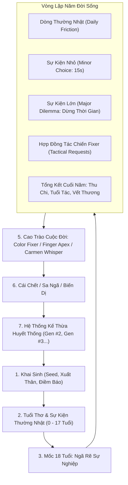
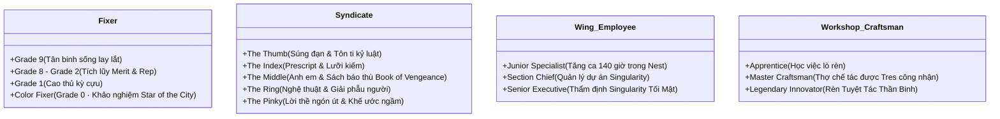

# THE CITY CHRONICLES: PROJECT MOON LIFE SIM
> **Tài liệu tổng quan hệ thống Gameplay, Cốt truyện & Xử lý Logic tình huống**
> *Dành cho người chơi, bạn bè và cộng đồng trải nghiệm dự án.*

- **Live Demo Vercel**: [https://project-moon-life-five.vercel.app](https://project-moon-life-five.vercel.app)
- **Thể loại**: Roguelike Text Life Simulator, RPG Sinh tồn, Narrative Drama
- **Bối cảnh**: Vũ trụ Project Moon (*Lobotomy Corporation*, *Library of Ruina*, *Limbus Company*) kết hợp phân tích tâm lý nội tâm kiểu *Disco Elysium*.

---

## 1. Giới thiệu Bối Cảnh (The World of The City)

The City là một siêu đô thị tàn khốc và kỳ vĩ được chia thành **26 Quận (Districts A - Z)**, quản trị tối cao bởi **The Head** (A Corp - Lập pháp & Thuế, B Corp - Giám sát toàn giác Beholder, C Corp - Trừng phạt bằng Claw & Arbiter).

Trong mỗi Quận có hai thế giới hoàn toàn tương phản:
- **The Nest (Tổ)**: Khu vực trung tâm của các siêu tập đoàn **Wing (Corp)** nắm giữ các **Singularity** (công nghệ kỳ tích phá vỡ quy luật tự nhiên: điều khiển thời gian, bẻ cong không gian, trích xuất linh hồn, nhân bản vô tính...). Nơi đây an toàn, giàu có, y tế tiên tiến nhưng ngột ngạt và đầy rẫy sự bóc lột cùng bí mật kinh hoàng.
- **The Backstreets (Phố Ngầm)**: Vùng vô pháp bao bọc quanh Nest. Nơi đây không có cảnh sát hay luật pháp bảo vệ. Mọi thứ được định đoạt bởi súng đạn, các tổ chức ngầm **Syndicate** và các văn phòng giải quyết sự vụ **Fixer**. Cứ đúng **3:13 AM đến 4:34 AM**, Đêm Quét Dọn (Night in the Backstreets) diễn ra: loài **Sweeper** biến dạng tràn ra dọn sạch mọi thứ trên đường thành nhiên liệu lỏng.
- **Outskirts & Ruins**: Vùng hoang vu ngoài rìa The City, chứa đựng các quái vật cổ xưa và những tàn tích cấm kỵ.

> Cư dân The City từ 18 tuổi phải tự trả tiền cho từng hơi thở và bước đi. Mọi lựa chọn đều để lại dấu vết nhân quả, và The City không bao giờ thương xót cho kẻ ngã xuống.

---

## 2. Vòng lặp Gameplay Chính (Core Gameplay Loop)

### A. Tiến Trình 1 Năm (Year-Planning Engine)
- Mỗi năm diễn ra tuần tự qua **4 Mùa: Xuân - Hạ - Thu - Đông**.
- Thanh thời gian chạy tự động (30s ở 1x, 15s ở 2x, 10s ở 3x). Người chơi có thể bấm Tạm Dừng (Pause), Tiếp Tục hoặc Tua Nhanh Qua Mùa.
- Cuối mỗi năm, engine tự động tính toán:
  - Thu nhập nghề nghiệp trừ chi phí sinh hoạt theo từng Quận.
  - Tự nhiên hồi phục vết thương, mức độ ảnh hưởng của môi trường sống (ô nhiễm, bạo lực).
  - Tác động tuổi già và bệnh tật.

### B. Bốn Loại Khoảnh Khắc (Encounter Hierarchy)
1. **Dòng Thường Nhật (Daily Life Friction)**: Tự động trôi qua cùng thanh thời gian, mang hơi thở cuộc sống chân thực: tiếng súng rền vang ở Backstreets, mùi mì gói rẻ tiền, đồng nghiệp than vãn tăng ca, kiểm tra vết mẻ trên lưỡi kiếm... Tác động nhẹ vào chỉ số (+/- 1-3 điểm).
2. **Sự Kiện Nhỏ (Minor Interactive Choices)**: Xuất hiện dưới dạng dock viền xanh có đồng hồ đếm ngược 15 giây. Đòi hỏi phản xạ quyết đoán: can thiệp một vụ ẩu đả, mua tin tình báo, giúp đỡ kẻ bị thương... Nếu hết thời gian mà không chọn, cơ hội sẽ tự trôi qua.
3. **Sự Kiện Lớn (Major Narrative Dilemmas)**: Tự động dừng dòng thời gian. Đi kèm hình minh họa và tiêu đề trang trọng. Đây là các ngã rẽ định đoạt số phận: thanh trừng nội bộ, khảo nghiệm lên chức, cạm bẫy của The Head, hoặc gieo mầm "Quả Báo Hẹn Giờ" (Karma Thread) sẽ ập đến sau nhiều năm.
4. **Hợp Đồng Tác Chiến Của Fixer (Tactical Requests)**: Cơ chế tính toán xác suất chiến thuật dựa trên cấp bậc Grade, trang bị, HP/SP và rủi ro. Người chơi chọn hướng tiếp cận: xung phong trực diện, phục kích ám toán, hoặc dùng mưu mẹo.

### C. Hệ Thống Chỉ Số & Tài Nguyên Sinh Tồn
- **Health (HP)**: Máu/Thể lực. Chạm 0 là tử vong.
- **Sanity (SP)**: Tinh thần và sự tỉnh táo. Khi Sanity chạm đáy, nhân vật rơi vào hoảng loạn tột độ và có nguy cơ nghe thấy "Lời Thì Thầm Của Carmen".
- **Wealth (Ahn)**: Đơn vị tiền tệ chuẩn của The City. Chi trả sinh hoạt, mua vũ khí, đóng phí bảo vệ, hối lộ.
- **Reputation (Rep)**: Uy danh xã hội và danh tiếng giang hồ.
- **Network**: Mạng lưới quan hệ ngầm, tai mắt và đồng minh.
- **Heat**: Mức độ bị truy nã và chú ý thù địch từ các phe phái.
- **Taboo**: Điểm chạm vào Điều Cấm của The Head. Vượt quá ngưỡng an toàn sẽ bị Beholder ghi sổ và Claw/Arbiter xuất hiện xóa sổ.
- **Resonance**: Độ cộng hưởng ánh sáng, quyết định sự thức tỉnh E.G.O hoặc sa ngã Distortion.

---

## 3. Bốn Nhánh Sự Nghiệp & Phe Phái Lớn

### 1. Fixer (Người Giải Quyết Sự Vụ)
- Khởi đầu với tấm thẻ Grade 9 mỏng manh, nhận các hợp đồng bèo bọt của cư dân nghèo.
- Tích lũy công trạng (Merit) và danh tiếng (Rep) để thăng hạng dần từ Grade 8 lên Grade 1.
- Gia nhập các Văn phòng danh tiếng (Dawn Office, Shi Association, Zwei Association, Liu Association...).
- **Đỉnh cao tối thượng**: Trở thành **Color Fixer (Grade 0)**. Hana Association Section 1 sẽ triệu tập người chơi vào Đại Khảo Thí đối đầu với một mối họa cấp độ **Star of the City** (Ngôi Sao Của The City). Chiến thắng sẽ được ghi danh vào đài danh vọng tối cao và nhận danh hiệu màu sắc độc bản (The Red Gaze, The Black Silence, The Indigo Elder...).

### 2. The Five Fingers (Năm Ngón Tay Thống Trị Thế Giới Ngầm)
Người chơi có thể chọn tuyên thệ trung thành với một trong Năm Ngón Tay:
- **The Thumb (Ngón Cái)**: Kỷ luật thép và lễ nghi tôn ti tuyệt đối. Súng đạn và mệnh lệnh từ trên xuống. Cắt lưỡi nếu nói năng vô lễ. Thang bậc: Soldato -> Capo -> Sottocapo -> Capo dei Capi.
- **The Index (Ngón Trỏ)**: Phục tùng tuyệt đối các chỉ thị kỳ bí từ mẩu giấy Prescript. Không hỏi tại sao, chỉ có chấp hành. Thang bậc: Proselyte -> Proxy -> Weaver.
- **The Middle (Ngón Giữa)**: Tình anh em đại gia đình thiêng liêng. Bất kỳ ai đụng đến một người anh em sẽ bị ghi tên bằng máu vào cuốn sổ phục thù **Book of Vengeance**. Thang bậc: Little Sibling -> Big Sibling -> Great Sibling.
- **The Ring (Ngón Áp Út)**: Đỉnh cao nghệ thuật biến dị. Xem cơ thể người và cái chết là chất liệu sáng tạo. Thang bậc: Student -> Docent -> Maestro.
- **The Pinky (Ngón Út)**: Khế ước ngầm trong bóng tối sâu nhất của Backstreets. Lời thề móc tay nặng hơn mạng sống. Thang bậc: Initiate -> Star Blade.

### 3. Wing Employee (Feather Của 26 Tập Đoàn Wing)
- Sống trong Nest xa hoa, hưởng chế độ chăm sóc y tế tối tân nhưng bị bóc lột đến tận xương tủy.
- Chạm tay vào các Singularity tối mật (cỗ tàu WARP, nước mắt phục hồi K Corp, trại nhân bản R Corp...).
- Thang thăng tiến: Chuyên viên tập sự -> Trưởng phòng (Section Chief) -> Giám đốc điều hành cấp cao (Senior Executive).

### 4. Workshop Craftsman (Thợ Rèn & Chế Tác Vũ Khí)
- Rèn đúc vũ khí, khiên giáp hỗ trợ cho Fixer và Syndicate dưới sự kiểm duyệt bản quyền gắt gao của Tres Association.
- Thang thăng tiến: Học việc -> Thợ bậc thầy (Master Craftsman) -> Nghệ nhân huyền thoại (Legendary Innovator).
- **Đỉnh cao**: Khảo nghiệm Rèn Tuyệt Tác Thần Binh (Masterpiece Forge) — tự tay đặt tên và tôi luyện vũ khí mang linh hồn riêng biệt.

---

## 4. Xử Lý Logic Tình Huống Sâu Sắc (Advanced Logic Engine)

### A. Weaver AI — Đạo Diễn Số Phận
- Không dùng ngẫu nhiên may rủi thuần túy. Weaver AI hoạt động như một hệ thống Utility AI đo lường tâm lý và bối cảnh:
  - **Drama Pacing**: Tự động cân bằng giữa cao trào (Climax) và khoảng lặng (Breathing Room). Sau một biến cố tàn khốc, engine sẽ ưu tiên sự kiện hồi phục; sau chuỗi ngày bình yên, engine sẽ thả vào biến cố thách thức.
  - **Hệ thống Ký ức & Quả báo hẹn giờ (Causal Threads)**: Một quyết định nhân từ hoặc tàn độc thời niên thiếu sẽ được gieo mầm vào hàng đợi nhân quả và bùng phát trở lại thành ân nhân hoặc kẻ thù sau 10 - 20 năm.
  - **Milestone Trực Giác**: Khi nhân vật tích lũy đủ Merit và Rep, Weaver AI sẽ tự động kích hoạt các bài thi thăng cấp đỉnh cao, không để người chơi bị kẹt trong ngẫu nhiên.

### B. Hệ Thống 5 Giọng Nói Nội Tâm (Disco Psyche)
Được lấy cảm hứng từ *Disco Elysium*, trước các quyết định sinh tử, 5 giác quan tâm trí sẽ đồng thanh lên tiếng:
1. **Logic**: Tính toán xác suất lạnh lùng, lợi ích vật chất và hiệu quả chiến thuật.
2. **Empathy**: Thấu cảm nỗi đau con người, cứu rỗi nhân tính giữa The City vô tình.
3. **Volition**: Ý chí quật cường, chiếc neo giữ vững sự tỉnh táo trước cám dỗ.
4. **Inland Empire**: Trực giác tâm linh, linh cảm về điềm báo và những quy luật siêu hình.
5. **Half Light**: Bản năng sinh tồn nguyên thủy, cảnh giác điên cuồng và phản xạ giận dữ.

### C. Ngã Rẽ Tâm Linh: E.G.O Thức Tỉnh vs Sa Ngã Distortion
- **Tiếng thì thầm của Carmen**: Khi Sanity tụt xuống cực thấp (dưới 5) hoặc Resonance tăng vọt, người chơi sẽ đối thoại trực tiếp với Carmen dưới ánh mặt trời rực lửa thiêu đốt (The Scorching Sun). Carmen khuyên nhân vật hãy giải phóng bản ngã, trút bỏ xiềng xích trách nhiệm.
- **Distortion (Biến dị)**: Nếu đầu hàng tuyệt vọng, cơ thể nhân vật biến dạng thành quái vật dị hình mang sức mạnh hủy diệt kinh hoàng, mở ra lối chơi sinh tồn áp lực cao với sự săn đuổi của các Hiệp hội.
- **E.G.O (Ý chí hiển hóa)**: Nếu giữ vững niềm tin sắt đá và vượt qua Carmen, nhân vật thức tỉnh vũ khí và giáp linh hồn độc bản, tự đặt tên cho E.G.O của mình và đạt sức mạnh chiến đấu phi thường.

### D. Hệ Thống Huyết Thống & Kế Thừa Thời Gian Thực (Lineage & Succession)
Khi nhân vật qua đời, nếu có con cái, người chơi có thể chọn chơi tiếp thế hệ tiếp theo:
1. **Khởi đầu từ 0 tuổi (Living Parent Mentorship)**:
   - Người con bắt đầu từ thời thơ ấu. Nhân vật cha/mẹ đời trước vẫn còn sống trong hồ sơ NPC gia đình, hàng năm chu cấp tiền bạc, bảo bọc con khỏi hiểm họa đường phố.
   - Đúng vào năm người con chạm đến độ tuổi cha/mẹ ngã xuống trong lịch sử, sự kiện **"Bóng Lưng Cuối Cùng" (The Historic Fall)** sẽ kích hoạt, tái hiện lại sự ra đi của cha mẹ và chính thức chuyển giao toàn bộ di sản.
2. **Tiếp quản ngay ở tuổi 18 (Take Over at 18)**:
   - Dành cho người muốn vào ngay mạch truyện trưởng thành.
   - Kế thừa toàn bộ di vật gia tộc (Heirloom Relic), tài sản thừa kế, và cả các món nợ máu truyền kiếp (Inherited Vendetta).
3. **Tính năng Reset Phả Hệ**:
   - Người chơi có thể xóa bỏ bất kỳ hồ sơ tưởng niệm nào hoặc xóa sạch toàn bộ phả hệ để bắt đầu lại một dòng họ Gen #1 hoàn toàn mới.

---

## 5. Công Nghệ Độc Lập & Trải Nghiệm Người Chơi

- **Chơi Độc Lập 100% Trên Vercel**: 
  - Địa chỉ: `https://project-moon-life-five.vercel.app`
  - Bạn bè có thể truy cập bằng điện thoại, máy tính bảng hoặc PC từ bất kỳ đâu, không cần cùng mạng Wi-Fi và không cần mở server trên máy tính.
- **Kiến Trúc Lưu Trữ Kép (Dual-Save Architecture)**:
  - Tự động lưu tiến trình trên `localStorage` của trình duyệt. Dù mất mạng, đổi tab hay tắt trình duyệt, khi vào lại vẫn chơi tiếp mượt mà.
  - Tự động đồng bộ với Backend C# .NET Minimal API khi có mạng để lưu trữ an toàn lâu dài.
- **Kế hoạch Tinh chỉnh Giao diện Điện Thoại (Mobile Dedicated HUD)**:
  - Thiết kế lại cụm hiển thị chỉ số sinh tồn (HP, SP, Ahn, Heat, Taboo) thành thanh nổi cố định trực quan, tối ưu tuyệt đối cho thao tác một tay trên màn hình dọc.

---
*The City does not weep for the fallen. Hãy khắc tên mình lên bia đá của The City.*
