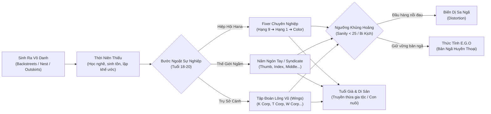
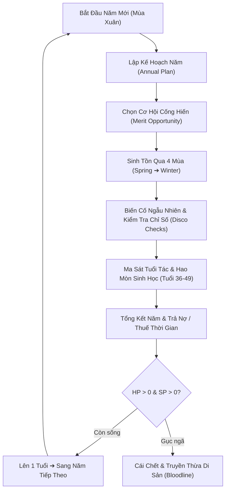

# THE CITY CHRONICLES: HỒ SƠ TOÀN CẢNH DỰ ÁN
> **Thể loại:** Narrative Life-Simulator · Roguelite RPG · Emergent Storytelling  
> **Vũ trụ:** Project Moon Universe (The City, Lobotomy Corp, Library of Ruina, Limbus Company)  
> **Ngôn ngữ:** Song ngữ hoàn chỉnh (Tiếng Việt & English)  
> **Nền tảng:** Web & Mobile Responsive (PWA ready)

---

## 1. TỔNG QUAN DỰ ÁN & ĐỊNH VỊ (ELEVATOR PITCH)

### 1.1. Trò Chơi Này Là Gì?
**The City Chronicles** là một tựa game mô phỏng đời sống (Life-Simulator) kết hợp chất nhập vai sinh tồn khắc nghiệt (Roguelite RPG) đặt trong thế giới tàn khốc, huyền ảo và ngột ngạt của **Project Moon Universe**.

Thay vì chỉ đọc một cuốn tiểu thuyết hình ảnh tuyến tính (Visual Novel) hay chơi một game thẻ bài chiến đấu đơn thuần, người chơi sẽ:
* **Hóa thân vào một sinh mệnh vô danh:** Sinh ra tại một trong 26 Quận (Districts) của The City hoặc dạt vào từ Ngoài Bờ Cõi (Outskirts).
* **Trải qua từng năm tháng cuộc đời (từ 0 đến 80+ tuổi):** Trải nghiệm 4 mùa trong năm, đối mặt với nghèo đói, nợ nần, bạo lực băng đảng, sự nghiền nát của các tập đoàn Wings và bóng ma tâm lý cá nhân.
* **Tự kiến tạo số phận thông qua Nhân Quả Tự Nhiên (Emergent Causality):** Không có menu "chọn sẵn tương lai" kiểu sandbox. Mọi cơ hội, thảm kịch, con đường thăng tiến hay sự biến dị đều bắt nguồn hữu cơ từ những gì bạn đã trải qua, những vết sẹo bạn mang và cách bạn phản ứng trước nghịch cảnh.



---

### 1.2. Triết Lý Thiết Kế: "Hard but Fair" & Cảm Hứng Tác Phẩm
Hệ thống gameplay của *The City Chronicles* được xây dựng dựa trên sự giao thoa giữa 4 tượng đài kinh điển:

1. **Darkest Dungeon (Sự Hao Mòn & Vết Sẹo Thể Xác - Attrition):**
   * Chiến đấu và làm việc tại The City để lại những chấn thương vĩnh viễn (Scars). Cơ thể con người không phải cỗ máy vô tận: bước vào tuổi trung niên (36–49 tuổi), những khớp cơ khí rỉ sét và vết sẹo cũ sẽ đòi hỏi tiền mua thuốc giảm đau, dầu bôi trơn và bảo trì hàng năm.
2. **Disco Elysium (Giọng Nói Nội Tâm & Kiểm Tra Kỹ Năng - Skill Checks):**
   * Các quyết định sinh tử sử dụng hệ thống kiểm tra chỉ số động (Disco Checks) dựa trên Máu, Tinh thần, Tiền bạc (Ahn), Tiếng tăm, Mạng lưới quan hệ và Điểm cộng hưởng. Tiếng thì thầm của Carmen hay trực giác mách bảo trỗi dậy từ sâu thẳm tâm trí.
3. **Sunless Sea & Sunless Skies (Nỗi Kinh Hoàng Vô Tận & Sự Bất Khả Tri):**
   * Không khí đen tối, văn phong trần thuật lạnh lùng (Bureaucratic Noir) với những bản án bất ngờ, các chuyến thám hiểm Outskirts đầy rủi ro và các bản giao kèo tính bằng mạng sống.
4. **Franz Kafka & Fyodor Dostoevsky (Chiều Sâu Tâm Lý & Sự Vô Cảm Của Bộ Máy):**
   * Những quy định quan liêu hà khắc của Hana Association, các điều cấm kỵ (Taboo) của The Head và cái giá đắt đỏ của việc giữ gìn nhân tính giữa một thành phố ăn thịt người.

---

## 2. BẢN ĐỒ CÁC TUYẾN NHÁNH NGHỀ NGHIỆP (CAREER ROUTES)

Game sở hữu **6 nhánh sự nghiệp lớn** cùng **2 trạng thái biến dị siêu nhiên**, mỗi nhánh đều có cây tiến trình, sự kiện riêng biệt và cơ chế thăng tiến độc bản:

### 2.1. Nhánh 1: Fixer Chuyên Nghiệp (Hiệp Hội Hana Quản Lý)
* **Bản chất:** Lính đánh thuê được cấp phép, giải quyết từ việc vặt Backstreets đến các cuộc thảm sát dị thường.
* **Tiến trình:**
  * **Fixer Hạng 9 đến Hạng 6:** Giai đoạn tân binh chật vật, kiếm từng đồng Ahn trả nợ văn phòng, đối mặt với cướp giật và chuột cống Backstreets.
  * **Fixer Hạng 5 (Cột mốc Office):** Đủ tư cách tách ra tự thành lập Văn phòng riêng (Fixer Office), tuyển dụng cộng sự, nhận hợp đồng thầu phụ.
  * **Fixer Hạng 4 đến Hạng 2:** Tham gia giải quyết các cuộc thanh trừng băng đảng lớn, nhận tài trợ từ các Hiệp hội chuyên môn (Zwei, Shi, Liu, Seven, Dieci...).
  * **Fixer Hạng 1:** Đỉnh cao năng lực phàm nhân, giải quyết các thảm họa cấp Star of the City.
  * **Color Fixer (Huyền Thoại Sắc Màu):** Đạt danh hiệu màu độc bản từ Hana (như *Red Gaze, Black Silence, Purple Tear, Vermilion Cross*...). Không nhảy cấp bừa bãi; chỉ dành cho kẻ sống sót qua hàng chục trận sinh tử.

### 2.2. Nhánh 2: Năm Ngón Tay Backstreets (The Five Fingers)
Thế giới ngầm được cai trị bởi 5 đại Syndicate khổng lồ, mỗi ngón tay mang một triết lý và luật lệ tàn khốc riêng:
* **Ngón Cái (The Thumb):** Tôn ti trật tự tuyệt đối. Bất kính với cấp trên là tội chết. Sử dụng súng đạn tinh xảo và nghi thức giao tiếp cực kỳ nghiêm ngặt.
* **Ngón Trỏ (The Index):** Tín đồ của Khế Ước (Prescripts). Những mảnh giấy chỉ thị vô lý (như *"hãy chặt ngón tay người thứ ba bạn gặp"* hay *"uống một tách trà trước khi ám sát"*). Tuân lệnh mù quáng để leo lên hàng Proxy và Messenger.
* **Ngón Giữa (The Middle):** Tình anh em đẫm máu. Mọi sự xúc phạm đến "gia đình" đều được ghi vào Sổ Thù Hận (Vengeance Book) xăm trên da thịt. Thù ắt phải trả bằng mạng.
* **Ngón Nhẫn (The Ring):** Nghệ thuật tàn sát thể nghiệm. Biến cơ thể nạn nhân thành tác phẩm điêu khắc và tranh vẽ. Tiến cấp từ Sinh viên lên Docent và Maestro.
* **Ngón Út (The Pinky):** Mạng lưới lời hứa, chợ đen và những giao kèo ma thuật ngầm chi phối khắp các hẻm tối.

### 2.3. Nhánh 3: Syndicate Độc Lập (Independent Syndicate)
* **Bản chất:** Dành cho người chơi từ chối quỳ gối trước 5 Ngón Tay, tự lập băng đảng riêng ở Backstreets.
* **Cơ chế:** Phải liên tục cân bằng giữa Điểm Danh Tiếng (Merit) và Điểm Bị Truy Nã (Heat). Bạn phải đối đầu với cả cảnh sát quận lẫn sự chèn ép của các Ngón Tay để xây dựng đế chế ngầm độc lập.

### 2.4. Nhánh 4: Cánh Tập Đoàn (The Wings of The City)
* **Bản chất:** Trở thành nhân viên cổ cồn trắng hoặc nhà nghiên cứu của 26 Siêu tập đoàn (Megacorporations):
  * **T Corp (Quận 20):** Công nghệ Thời Gian. Thuế thời gian hà khắc, máy hút thời gian sống của cư dân.
  * **K Corp (Quận 11):** Nước Mắt Hồi Phục (Tear of Healing) & Tinh chất Ampoule tái tạo tế bào tức thì, che giấu bí mật ghê tởm đằng sau đôi mắt của Quái thú.
  * **W Corp (Quận 23):** Tàu Siêu Tốc WARP Train dịch chuyển tức thời — nơi che đậy sự tra tấn kéo dài hàng thiên niên kỷ giữa các chiều không gian.
  * **L Corp (Quận 12):** Tàn tích tập đoàn Năng lượng tiền nhiệm với các Dị thể (Abnormalities).

### 2.5. Nhánh 5: Thợ Xưởng Công Nghệ (Workshops, đã khép lại)
* **Hiện trạng:** Workshop không còn là nghề người chơi chọn được. Phần còn lại là thiết bị, vật phẩm và NPC thợ trong các nghề khác. Mô tả dưới đây giữ lại như thiết kế cũ.
* **Bản chất:** Kỹ sư chế tác trang bị, độ chi giả cơ khí (Augmentations), nghiên cứu hợp kim nano và vũ khí đặc chủng cho Fixer.
* **Rủi ro:** Cám dỗ nghiên cứu Công nghệ Cấm (Taboo), nguy cơ bị thanh tra của The Eye và The Claw ghé thăm.

### 2.6. Nhánh 6: Kẻ Sống Sót Bên Lề & Tàn Dư (Outcast / Sweeper)
* Vượt biên từ Outskirts vào City, sinh tồn bằng nghề nhặt phế liệu (Scavenger).
* Sinh tồn qua **Giờ Quét Dọn (Sweepers' Clean-up Hour, 3:13 AM - 4:34 AM)** mỗi đêm ở Backstreets khi những kẻ mặc đồ bảo hộ lỏng chuyển hóa mọi sinh vật thành nhiên liệu.

---

### 2.7. Cơ Chế Siêu Nhiên: Distortion (Sa Ngã) vs E.G.O (Bản Ngã)

Trong The City, khi một con người rơi vào tuyệt vọng cùng cực, tiếng thì thầm của **Carmen** sẽ vang lên bên tai:

| Trạng Thái | Điều Kiện Kích Hoạt | Bản Chất & Hệ Quả |
| :--- | :--- | :--- |
| **Distortion (Biến Dị)** | Tinh thần sụp đổ (`Sanity < 25`), mang nhiều sẹo, buông xuôi ý chí và chấp nhận tiếng gọi của ánh sáng. | Nhân vật đầu hàng bi kịch, cơ thể và tâm trí biến dị thành quái vật. Mất quyền làm Fixer con người, bước vào tuyến chơi quái dị tàn phá hoặc ẩn nấp. |
| **E.G.O Awakening** | Tinh thần bị thử thách khốc liệt nhưng ý chí sắt đá (`Willpower` cao, giữ vững bản ngã cá nhân). | Nhân vật tự biểu hiện vũ khí và giáp trụ sinh ra từ linh hồn mình. Đạt bước nhảy vọt về sức mạnh (E.G.O Leap), được miễn giảm điều kiện thăng hạng Fixer. |

---

## 3. HỆ THỐNG GAMEPLAY & VÒNG LẶP SINH TỒN (GAMEPLAY SYSTEMS)



### 3.1. Vòng Lặp Đời Người & Kế Hoạch Hàng Năm (Annual Plan Loop)
* Mỗi năm nhân vật sống qua 4 mùa: **Xuân - Hạ - Thu - Đông**.
* Đầu mỗi năm, người chơi nhận được các **Leads (Đầu mối cơ hội)**:
  * Đi làm thêm kiếm Ahn trả nợ.
  * Nhận hợp đồng khảo thí thăng hạng của Hiệp hội.
  * Tầm sư học đạo hoặc gia nhập băng đảng.
* Điểm cống hiến (Merit) và sự rèn luyện quyết định tư cách mở kỳ thi sát hạch vào cuối năm.

### 3.2. Hệ Thống Kiểm Tra Chỉ Số Phong Cách Disco Elysium
Mọi quyết định sinh tử đều được tính toán bằng công thức toán học minh bạch:
$$\text{Tỷ lệ thành công} = f(\text{Chỉ số liên quan}, \text{Công cụ hỗ trợ}, \text{Độ khó khế ước}) + \text{Xúc xắc ngầm}$$
* **Chỉ số:** Sức Khỏe (HP), Tinh Thần (SP), Tài Sản (Ahn), Độ Nguy Hiểm/Truy Nã (Heat), Quan Hệ (Network), Danh Tiếng (Reputation), Cộng Hưởng (Resonance).
* Thất bại không bao giờ là ngõ cụt: Thất bại mở ra nhánh câu chuyện mới (bị thương tích, mang nợ ngầm, dạt sang quận khác).

### 3.3. Ma Sát Sinh Học & Gánh Nặng Tuổi Trung Niên (Ages 36–49)
Khác với các game nơi nhân vật càng già càng bất tử, tại The City:
* Từ tuổi 36 trở đi, nếu nhân vật có từ 2 vết sẹo trở lên hoặc mang chi giả, cơ thể bắt đầu rệu rã.
* Hàng năm phát sinh **Phí bảo trì sinh học: 2 Ahn/năm** (tiền thuốc giảm đau, dầu bôi trơn khớp).
* **Nếu không đủ tiền:** Vết sẹo cũ tái phát, cơ thể suy kiệt (`-1 HP`, `-1 SP`), nhận cờ `PainSuppressantDeficit` khiến nhân vật bị run tay, giảm phản xạ trong các trận đấu sau đó.

### 3.4. Hệ Thống Điều Cấm Kỵ (Taboo) & Móng Vuốt The Head (The Claw)
* The City được vận hành bởi **The Head (A Corp, B Corp, C Corp)** với những luật lệ thép: Cấm súng đạn tầm xa xuyên phá cao, cấm trí tuệ nhân tạo có cảm xúc con người, cấm chế tạo bản sao vô hạn...
* Mỗi lần bạn vi phạm hoặc lén nghiên cứu đồ cấm, **Con Mắt Điều Cấm (Taboo Eyes)** sẽ mở dần.
* Khi 3 mắt mở trọn: **The Claw** (đao phủ tối cao của The Head) sẽ đích thân xuất hiện để thanh trừng. Cơ hội sống sót gần như bằng không nếu không có trang bị cấp thần thoại hoặc thức tỉnh E.G.O.

### 3.5. Hầm Ngục Khảo Thí & Đặt Cược Sinh Tử (Dungeon Gauntlet)
* Chế độ dấn thân vào các phế tích L Corp cũ hoặc hang ổ quái vật Outskirts.
* **Cơ chế Đặt cược Cửa Ải (Dungeon Entry Wager):** Chọn mức cược sinh mạng và tài sản trước khi bước qua cánh cổng. Càng đi sâu, phần thưởng cổ vật càng vô giá nhưng nguy cơ táng mạng càng cận kề.

### 3.6. Hệ Thống Dòng Máu & Di Sản Thừa Kế (Bloodline & Lineage)
Khi nhân vật qua đời (do tuổi già, bị sát hại hoặc sa ngã Distortion):
* Toàn bộ câu chuyện cuộc đời được đúc kết thành một cuốn **Biên Niên Sử (Chronicle)**.
* Tài sản tích lũy, các mối ân oán chưa trả, vũ khí xưởng chế tác có thể truyền lại cho **Con ruột**, **Đệ tử chân truyền** hoặc **Kẻ nhặt tàn dư Backstreets**. Đời sau sẽ khởi đầu với những đặc quyền và gánh nặng từ tiền nhân.

---

## 4. NGHỆ THUẬT GIAO DIỆN & TRẢI NGHIỆM XÚC GIÁC (UI/UX CRAFTSMANSHIP)

Game áp dụng triết lý nghệ thuật cao cấp từ bộ ba kỹ năng: **Impeccable**, **Hallmark** và **Design-Taste-Frontend**:

```
Bầu không khí: "The City at night, seen through smoked glass"
(Màn đêm The City nhìn qua lớp kính hun khói đen, điểm sắc vàng cổ kính và ánh đỏ sẫm)
```

### 4.1. Nút Lựa Chọn "Phiếu Khế Ước Xúc Giác" (Tactile Contract Slips)
* **Cảm giác bấm:** Mỗi nút lựa chọn không phải là một khối chữ nhật trơ trọi, mà được thiết kế như một **tờ phiếu giao kèo văn phòng**.
* **Phản hồi cơ học:** Rê chuột trên máy tính làm nút nâng nhẹ `1px` với quầng sáng vàng dịu `--ambient-rim`. Khi click hoặc chạm trên điện thoại, nút lún nhẹ `1px` mang lại cảm giác nhấn công tắc cơ học thật sự.
* **Con dấu số niêm phong (`.choice-badge`):** Đánh số thứ tự theo phong cách con dấu sáp đỏ/vàng của các cơ quan The City với phông số cân đối (`tabular-nums`).

### 4.2. Chữ Đầu Cổ Điển Khắc Ghi Cột Mốc Lớn (Drop Cap Inscription)
* Mỗi khi nhân vật đạt được một bước ngoặt lớn của cuộc đời (đậu kỳ thi Fixer, được phong Color, thức tỉnh E.G.O, sống sót qua một cuộc thảm sát), văn bản ghi chép sẽ tự động khoác khung viền biên niên sử sang trọng với **chữ cái đầu dòng cổ điển (Drop Cap Literata)** phóng lớn và nhuộm màu vàng sáp ấm áp.

### 4.3. Thanh Sinh Mệnh Phân Đoạn & Nhịp Thở Báo Động (Segmented Vitals Pulse)
* Thanh Máu (HP) và Tinh Thần (SP) được chia vạch cơ khí tinh xảo như đồng hồ đo áp suất.
* Khi chỉ số giảm xuống dưới ngưỡng nguy kịch ($< 25$), thanh thông số và nhãn chỉ số sẽ phát **nhịp đập cảnh báo chậm (Critical Pulse)** đỏ rực, đồng bộ với hiệu ứng âm thanh tim đập dồn dập.

### 4.4. Tối Ưu Công Thái Học Tuyệt Đối Trên Điện Thoại (Mobile-First Ergonomics)
* **Zero Lag:** Tích hợp `touch-action: manipulation` triệt tiêu hoàn toàn độ trễ 300ms trên màn hình cảm ứng di động.
* **Đèn ngọc báo vị trí (Glowing Indicator):** Thanh điều hướng dưới đáy màn hình (Bottom Nav) hiển thị chấm phát quang ngọc bích tinh xảo dưới tab đang chọn.
* **Bảng hồ sơ dạng ngăn kéo (Tactile Bottom Sheet):** Vuốt nhẹ để mở hồ sơ nhân vật, xem trang bị, quan hệ và mục tiêu sự nghiệp với thanh nắm vuốt xúc giác bo tròn chuẩn công thái học.

---

## 5. BẢNG THỐNG KÊ QUY MÔ DỰ ÁN (BY THE NUMBERS)

| Hạng mục nội dung | Số lượng | Ghi chú kỹ thuật |
| :--- | :--- | :--- |
| **Sự kiện Cốt truyện Lớn (Major Events)** | **766** | Các sự kiện bước ngoặt cuộc đời có nhánh rẽ sâu |
| **Sự kiện Nhánh Phụ (Minor Events)** | **866** | Các cuộc gặp gỡ, công việc và biến cố ngẫu nhiên |
| **Dòng Nhật Ký Đời Thường (Daily Events)** | **572** | Những chi tiết sinh động về ẩm thực, thời tiết, sinh hoạt |
| **Biến Cố Vĩ Mô Toàn Cầu (Macro Shocks)** | **44** | Thuế thời gian T Corp, thu hồi thuốc K Corp, Sweeper... |
| **Hợp Đồng Cực Hiểm (Hazardous Contracts)** | **36** | Các hợp đồng săn Dị thể và thanh trừng băng đảng |
| **Chuỗi Kiểm Thử Văn Phong (Voice Lint)** | **32,717** | 0 lỗi từ cấm, 0 đại từ sai canon, 0 emoji bừa bãi |
| **Bộ Kiểm Thử Tự Động (Test Suites)** | **57 / 57** | Vượt qua 100% tất cả các trường hợp biên và hồi quy logic |
| **Mô Phỏng Cuộc Đời (Million Audit Sim)** | **500 cuộc đời** | Kiểm định toàn vẹn không sót lỗi ghost NPC hay skip rank |

---

## 6. HƯỚNG DẪN TRẢI NGHIỆM NHANH (HOW TO PLAY)

1. **Khởi chạy ứng dụng:** Chạy lệnh `npm run dev` trên terminal và mở trình duyệt tại `http://localhost:5173`.
2. **Khởi tạo sinh mệnh:** 
   - Đặt tên hoặc nhận tên ngẫu nhiên theo phong cách City.
   - Quay xúc xắc số phận để nhận Quận xuất thân (District 1 đến 26 hoặc Outskirts).
3. **Quản lý tài nguyên sống:**
   - Luôn để ý chỉ số **Ahn** (tiền bạc) để không bị tịch thu tài sản hoặc bán nội tạng.
   - Giữ **Sanity** ở mức an toàn nếu không muốn Carmen ghé thăm biến bạn thành Distortion.
4. **Quyết định từng mùa:** Bấm phím cách (Space) hoặc nút tiến mùa để cuộc đời trôi đi, đọc kỹ hậu quả trên tờ khế ước trước khi ký tên lựa chọn!
